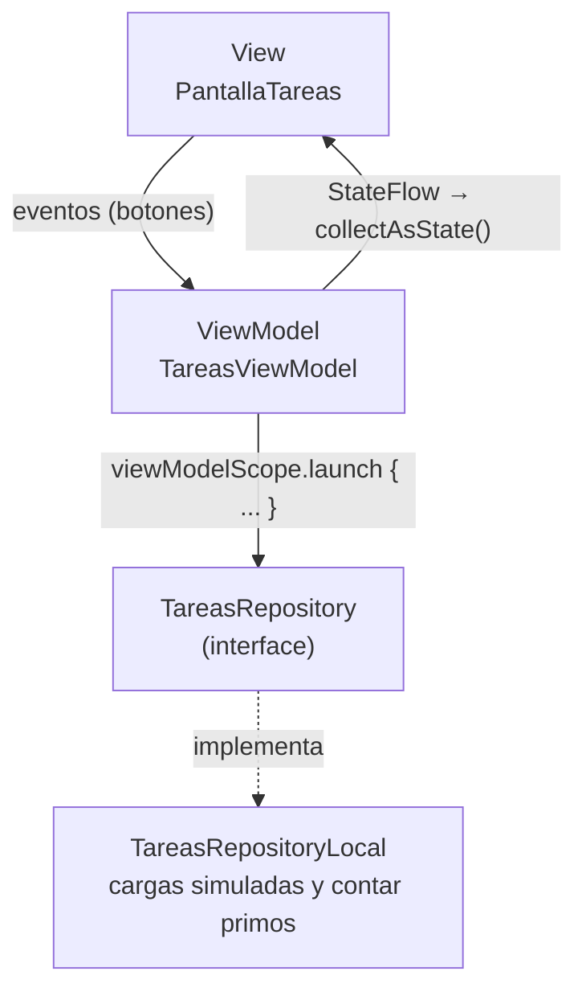
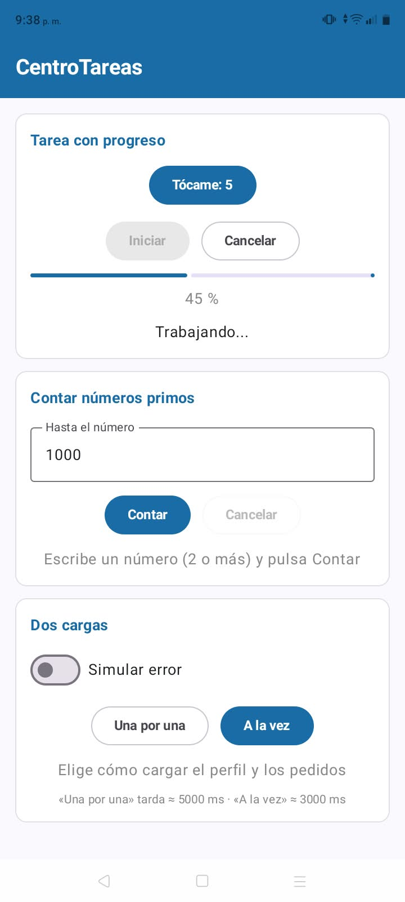
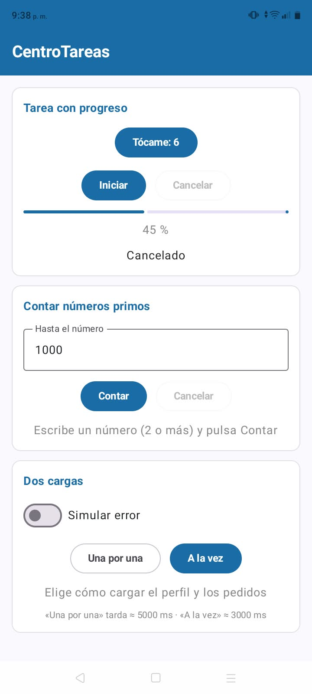
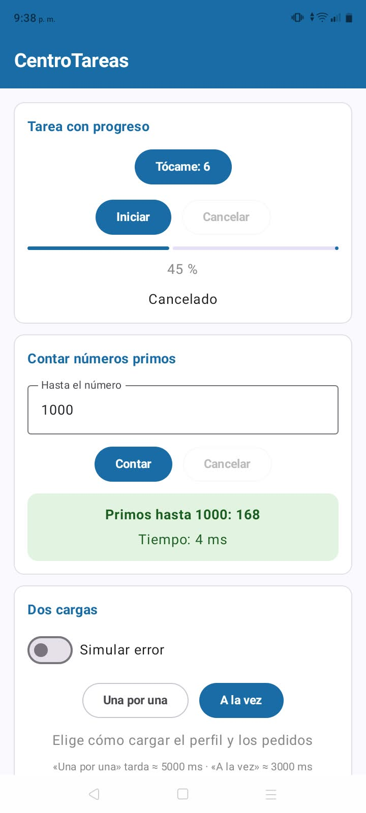
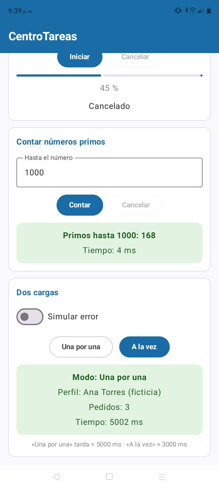
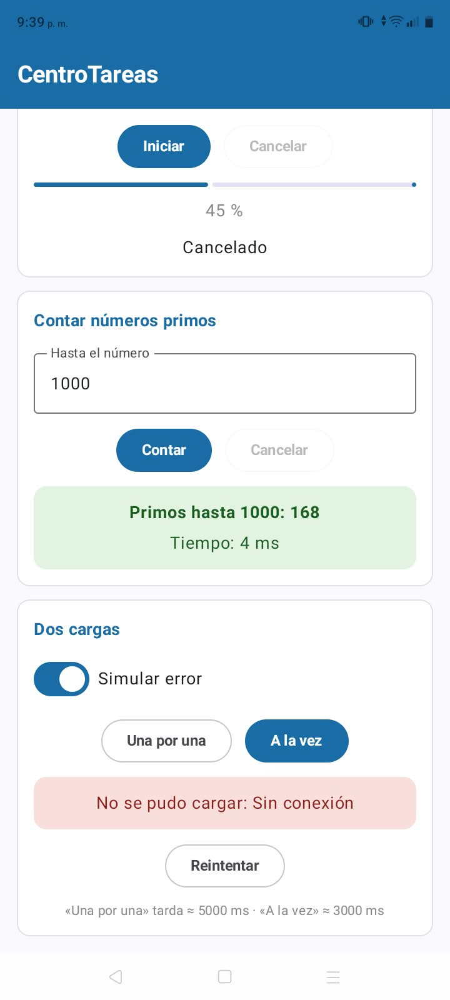
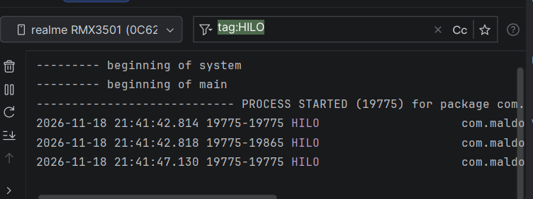

# CentroTareas

App Android (Kotlin + Jetpack Compose + Material 3) para practicar **hilos y corrutinas**. Hace tres cosas que tardan: una tarea con barra de progreso, un cálculo pesado (contar números primos) y dos cargas de datos simuladas. Primero muestra cómo se **congela** la pantalla cuando el trabajo largo corre en el hilo principal, y después lo resuelve con **corrutinas** sin bloquearlo nunca.

> Laboratorio **GLAB-S14 · Hilos en Android** · Programación en Móviles · Docente: Juan León S.
> Autor: Luis Maldonado

---

## Tecnologías

| Tecnología | Uso en el proyecto |
|---|---|
| Kotlin | Lenguaje de toda la app |
| Jetpack Compose + Material 3 | Interfaz sin XML: tarjetas, botones, barra de progreso, interruptor |
| Corrutinas (`launch`, `async`, `withContext`, `delay`) | Trabajo en segundo plano sin bloquear el hilo principal |
| `viewModelScope` | Alcance de las corrutinas: se cancelan solas cuando el ViewModel se destruye |
| `StateFlow` | Estado que la pantalla observa con `collectAsState()` |
| `lifecycle-viewmodel-compose` | Para obtener el `TareasViewModel` con `viewModel()` desde Compose |

**Sin permisos ni internet:** las cargas son simuladas con `delay`, así que el `AndroidManifest.xml` no declara ningún permiso.

---

## Funcionalidades

| Tarjeta | Qué hace |
|---|---|
| **Tarea con progreso** | Botón **Tócame** (prueba de vida), **Iniciar** y **Cancelar**, barra de 0 a 100 % en ≈ 4 s |
| **Contar números primos** | Cuenta los primos hasta N en `Dispatchers.Default`, muestra la cantidad y el tiempo, y se puede cancelar |
| **Dos cargas** | Compara **Una por una** (≈ 5 s) contra **A la vez** con `async` (≈ 3 s); interruptor **Simular error** y botón **Reintentar** |

---

## Estructura de paquetes

```
com.maldonado.centrotareas/
├── MainActivity.kt                    [E] crea el ViewModel con su Factory
├── model/
│   └── Estados.kt                     [E] PrimosUi, CargaUi
├── data/
│   ├── TareasRepository.kt            [E] interface
│   └── TareasRepositoryLocal.kt       [G] cargas simuladas + contarPrimos
├── viewmodel/
│   ├── TareasViewModel.kt             [G] corrutinas, Job, StateFlow (pasos 1 a 7)
│   └── TareasViewModelFactory.kt      [E]
└── ui/
    ├── PantallaTareas.kt              [G] las tres tarjetas
    └── theme/                         [E] tema azul
```

---

## Arquitectura MVVM + Repository



| Capa | Conoce a | No debe |
|---|---|---|
| View (`ui/`) | Solo a su ViewModel | Lanzar corrutinas ni usar `Thread`; solo muestra el estado y avisa los eventos |
| ViewModel | Solo a la interface del Repository | Conocer Composables, recibir un `Context` ni bloquear el hilo principal |
| Repository | Nada de la UI | Exponer estados de pantalla; sus funciones `suspend` no bloquean el hilo desde el que se llaman |

---

## Observación del Paso 1

**¿Qué pasa con la pantalla?**
Al pulsar **Tarea larga (MAL)** la app se queda congelada unos 4 segundos. El botón **Tócame** no responde: el contador no sube mientras dura la espera. Los toques hechos en ese tiempo no se ven en el momento. Cuando termina la espera, la pantalla vuelve de golpe y el texto pasa directamente a **Terminó**.

**¿Por qué no se ve "Trabajando..."?**
`tareaLargaMala()` se ejecuta en el **hilo principal (main)**, que es el mismo que dibuja la pantalla y atiende los toques. El código cambia el mensaje a "Trabajando..." y en seguida llama a `Thread.sleep(4000)`, que **bloquea** ese hilo. Para mostrar el nuevo texto, Compose necesita que el hilo principal quede libre y pueda dibujar el siguiente cuadro, pero está dormido. Cuando por fin se libera, el mensaje ya cambió a "Terminó", así que "Trabajando..." nunca llega a dibujarse.

**¿Qué mostraría Android si la espera fuera de 10 segundos?**
Mostraría un diálogo **ANR (Application Not Responding)**: *"CentroTareas no responde"*, con las opciones **Cerrar app** o **Esperar**. Android lo muestra cuando el hilo principal no atiende un evento de entrada (un toque) en unos **5 segundos**. Por eso el trabajo largo nunca debe ir en el hilo principal.

---

## Capturas

| Tarea con progreso               | Cancelada               | Primos               |
|----------------------------------|-------------------------|----------------------|
|  |  |  |

| Una por una (≈ 5 s)       | A la vez (≈ 3 s)       | Error + Reintentar  |
|---------------------------|------------------------|---------------------|
|  |  |  |

**Logcat con el filtro `tag:HILO`** (`main` antes y después, `DefaultDispatcher-worker` dentro de `withContext`):



---

## Pruebas de aceptación

| Prueba | Resultado esperado | OK |
|---|---|---|
| Tarea larga: tocar **Tócame** mientras trabaja | El contador sigue sumando | ✅ |
| Logcat con filtro HILO | `main` antes y después; `DefaultDispatcher-worker` dentro | ✅ |
| Iniciar la tarea con progreso | La barra avanza de 0 a 100 % en ≈ 4 s | ✅ |
| Cancelar a mitad | La barra se detiene, dice **Cancelado** y se puede iniciar otra vez | ✅ |
| Pulsar **Iniciar** dos veces seguidas | No se lanzan dos tareas (el botón está deshabilitado) | ✅ |
| Primos hasta 1000 | Resultado **168** | ✅ |
| Primos con N grande | La pantalla no se congela y **Cancelar** funciona | ✅ |
| Una por una | ≈ 5 s y resultado correcto | ✅ |
| A la vez | ≈ 3 s y resultado correcto | ✅ |
| Error simulado + **Reintentar** | Recuadro rojo; al desactivar el interruptor y reintentar, éxito | ✅ |
| Rotar la pantalla durante la tarea | La tarea continúa y el progreso no se reinicia | ✅ |
| Revisar el código | `git grep` no encuentra `GlobalScope`, `runBlocking` ni `Thread.sleep` en el código final | ✅ |

Valores de referencia comprobados: primos hasta 100 = **25**, hasta 1000 = **168**, hasta 10 000 = **1229**, hasta 500 000 = **41 538**.

---

## Para pensar

**1. ¿Por qué no se veía "Trabajando..." en el Paso 1?**
Porque todo pasaba en el hilo principal. El mensaje sí cambiaba a "Trabajando...", pero justo después `Thread.sleep(4000)` dormía ese hilo y Compose no podía dibujar el siguiente cuadro. Cuando el hilo despertó, el mensaje ya era "Terminó", así que solo se dibujó ese valor.

**2. ¿Qué diferencia hay entre `Thread.sleep` y `delay`?**
`Thread.sleep` **bloquea** el hilo completo: nadie más puede usarlo mientras duerme, y si es el hilo principal, la pantalla se congela. `delay` es una función `suspend` que **suspende solo la corrutina**: el hilo queda libre para hacer otras cosas (dibujar, atender toques) y la corrutina continúa cuando pasa el tiempo. Además, `delay` revisa la cancelación, así que una corrutina cancelada se detiene en el `delay`; `Thread.sleep` no se entera.

**3. ¿Por qué `Dispatchers.Default` para los primos y `Dispatchers.IO` para la red?**
Contar primos es trabajo de **CPU**: el procesador está ocupado todo el tiempo. `Dispatchers.Default` tiene tantos hilos como núcleos tiene el procesador, que es lo ideal para cálculos. La red, la base de datos o los archivos son trabajo de **espera (E/S)**: el hilo pasa casi todo el tiempo esperando una respuesta. `Dispatchers.IO` tiene muchos más hilos, para que muchas esperas puedan ocurrir a la vez sin ocupar los hilos de cálculo.

**4. ¿Qué pasaría con la corrutina si el usuario cierra la pantalla? ¿Qué papel cumple `viewModelScope`?**
`viewModelScope` ata las corrutinas a la vida del ViewModel. Si el usuario **cierra** la pantalla de verdad, el ViewModel se destruye (`onCleared`) y `viewModelScope` **cancela automáticamente** todas sus corrutinas: no quedan tareas huérfanas gastando batería ni intentando actualizar una pantalla que ya no existe. Si solo **rota** la pantalla, el ViewModel sobrevive, así que la tarea sigue corriendo y el progreso no se reinicia (prueba de aceptación de rotación).

**5. ¿Por qué `async` tarda 3 s y no 5 s? ¿Qué pasa si una de las dos cargas falla?**
Con **Una por una**, la segunda carga no empieza hasta que termina la primera: 2 s + 3 s ≈ 5 s. Con `async`, las dos cargas **arrancan al mismo tiempo** y `await()` espera a ambas, así que el total es lo que tarda la más lenta: máximo(2 s, 3 s) ≈ 3 s. En las pruebas salió ≈ 3002 ms contra ≈ 5002 ms; los milisegundos extra son el costo de crear las corrutinas y volver al hilo principal.
Si una falla, como los pedidos con *Sin conexión*, la excepción sale del `coroutineScope`. Eso **cancela la otra carga** que todavía estuviera en curso, y el error llega al `try/catch` del ViewModel, que muestra **No se pudo cargar: Sin conexión** con el botón **Reintentar**. La app no se cierra. La `CancellationException` se deja pasar con `throw e` para no romper la cancelación.

---

## Historial de commits (Fase 1 · rama `main`)

| # | Commit |
|---|---|
| 1 | `chore: importa proyecto base CentroTareas` |
| 2 | `feat(hilos): provoca el congelamiento con Thread.sleep en el hilo principal` |
| 3 | `fix(hilos): mueve la tarea larga a una corrutina con withContext` |
| 4 | `feat(progreso): agrega barra de progreso con StateFlow` |
| 5 | `feat(cancelar): permite cancelar la tarea con Job` |
| 6 | `feat(primos): cuenta primos en Dispatchers.Default con cancelacion` |
| 7 | `feat(carga): compara carga secuencial y en paralelo con async` |
| 8 | `feat(errores): maneja errores de carga y agrega reintento` |
| 9 | `docs: agrega README con observaciones y capturas` |

## Cómo ejecutarlo

1. Clona el repositorio: `git clone https://github.com/LuisMaldo3/CentroTareas.git`
2. Ábrelo en Android Studio y espera a que Gradle sincronice.
3. Ejecuta en un emulador o celular con **Android 7.0 (API 24)** o superior.
